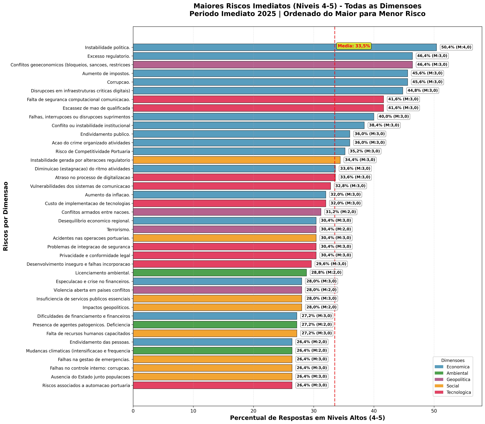
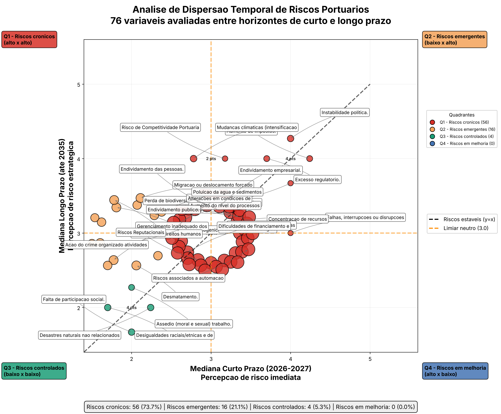
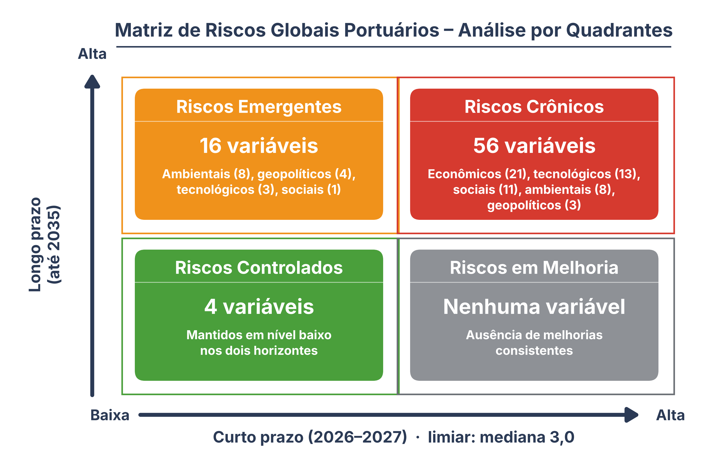
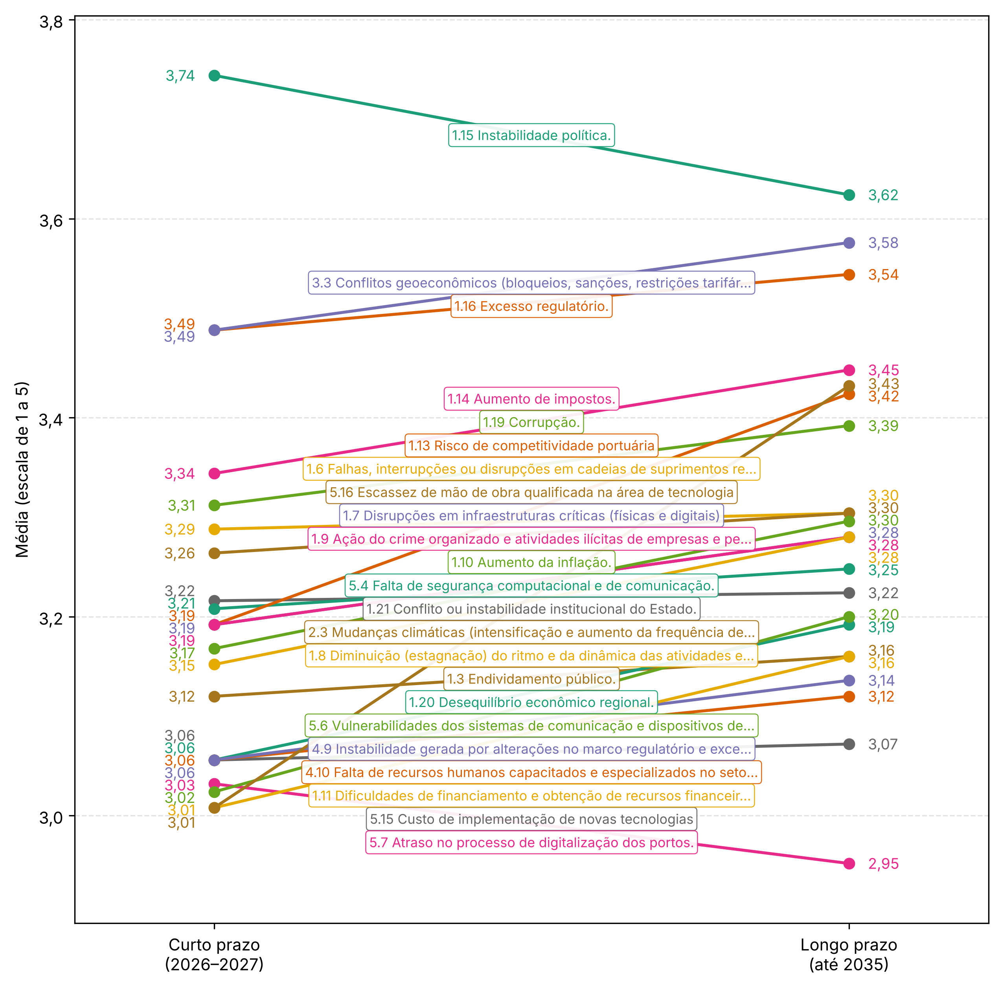

Mapeie neste capítulo as relações entre os diferentes riscos identificados, destacando efeitos em cascata e sinergias.

## Maiores Riscos Imediatos por Dimensão

O gráfico apresenta os 20 maiores riscos imediatos (período 2025) de todas as dimensões analisadas, ordenados do maior para o menor percentual de respostas em níveis altos (4-5). As cores diferenciam as dimensões, permitindo identificar padrões e concentrações de risco.



### Análise dos Principais Destaques

::: {.callout-important title="Riscos Críticos Identificados"}
Foram identificados **9 riscos críticos** (pelo menos 40% de percepção em níveis altos), nas dimensões Econômica, Geopolítica e Tecnológica:

1. **Instabilidade política** (Econômica): 50,4%;
2. **Excesso regulatório** (Econômica): 46,4%;
3. **Conflitos geoeconômicos** (Geopolítica): 46,4%;
4. **Aumento de impostos** (Econômica): 45,6%;
5. **Corrupção** (Econômica): 45,6%;
6. **Disrupções em infraestruturas críticas** (Econômica): 44,8%;
7. **Falta de segurança computacional** (Tecnológica): 41,6%;
8. **Escassez de mão de obra qualificada em tecnologia** (Tecnológica): 41,6%;
9. **Falhas em cadeias de suprimentos** (Econômica): 40,0%.
:::

### Padrões por Dimensão

-   **Dimensão Econômica**: Apresenta a maior concentração de riscos críticos, com 12 dos 20 maiores riscos e média de 40,3% de percepção de risco alto.
-   **Dimensão Geopolítica**: Embora com menor quantidade de riscos, apresenta níveis elevados, especialmente em conflitos geoeconômicos.
-   **Dimensões Social, Ambiental e Tecnológica**: Apresentam riscos mais moderados, mas ainda relevantes para gestão integrada.

```{python}
#| echo: false
#| warning: false
#| include: false

# O grafico de dispersao temporal AMPLIADO e gerado por gerar_grafico_dispersao_temporal_ampliado.py
# Caminho do arquivo: quarto/assets/graficos_agrupados/grafico_dispersao_temporal_riscos_ampliado.png
# Analise completa com os 76 pares (todas as variaveis do questionario)
```



### Principais Achados da Análise de Dispersão

O gráfico de dispersão temporal revela padrões importantes na evolução dos riscos entre o curto prazo (2026-2027) e longo prazo (até 2035):

#### Correlação e Persistência dos Riscos

- **Correlação moderada (r = 0,57)**: Indica que a hierarquia de riscos tende a se manter, mas com mudanças significativas em casos específicos
- **Delta médio de +0,22 ponto**: Sugere uma leve piora geral dos riscos ao longo do tempo
- **73,7% dos riscos são crônicos**: 56 das 76 variáveis permanecem em níveis elevados em ambos os horizontes temporais.

#### Análise por Quadrantes

- **Quadrante 1 - Riscos Crônicos (alto x alto)**: 56 variáveis, principalmente econômicas, tecnológicas e sociais
- **Quadrante 2 - Riscos Emergentes (baixo x alto)**: 16 variáveis, metade delas ambientais
- **Quadrante 3 - Riscos Controlados (baixo x baixo)**: 4 variáveis, mantidas sob controle
- **Quadrante 4 - Riscos em Melhoria (alto x baixo)**: Nenhuma variável, indicando ausência de melhorias consistentes.



#### Insights por Dimensão

- **Ambiental**: Piora temporal de +0,53, com 9 variáveis aumentando +1,0 ponto
- **Econômica**: Relativa estabilidade (delta 0,00), com riscos mantidos em níveis elevados
- **Geopolítica**: Maior piora temporal (delta +0,57), com 4 variáveis aumentando +1,0 ponto
- **Social**: Variação leve (delta +0,07), com preocupações consistentes sobre direitos humanos
- **Tecnológica**: Leve piora (delta +0,19), com 3 variáveis aumentando +1,0 ponto.

#### Implicações Estratégicas

A ausência de riscos em melhoria (Quadrante 4 vazio) e a predominância de riscos crônicos destacam a necessidade de ações preventivas e mitigatórias contínuas, especialmente para os desafios geopolíticos e ambientais, que mostram o maior agravamento temporal.

## Evolução Temporal

O gráfico a seguir apresenta a evolução das médias das 23 variáveis com média igual ou superior a 3,0 no curto prazo (2026-2027), conectando cada uma ao seu valor no longo prazo (até 2035). Cada linha corresponde a uma variável, identificada pelo código e pelo rótulo central.

{#fig-slopegraph-completo}

### Insights

#### Distribuição das Mudanças por Dimensão

- **Ambiental (17 variáveis)**: Segunda maior piora, com delta médio de +0,53
- **Econômica (21 variáveis)**: Menor variação, com delta médio de 0,00
- **Geopolítica (7 variáveis)**: Maior piora, com delta médio de +0,57
- **Social (15 variáveis)**: Piora leve, com delta médio de +0,07
- **Tecnológica (16 variáveis)**: Piora leve, com delta médio de +0,19.

#### Principais Padrões Identificados

**Pioras Críticas (+1,0 ponto) - 18 variáveis:**

- **Ambiental (9 variáveis)**: Mudanças climáticas, aumento do nível do mar, poluição, espécies exóticas, resíduos, desmatamento, ruídos, patógenos, produtos perigosos;
- **Geopolítica (4 variáveis)**: Terrorismo, liberação de contaminantes, alterações em sistemas terrestres, migração forçada;
- **Tecnológica (3 variáveis)**: Tecnologias avançadas, censura e vigilância adversa, navios autônomos;
- **Econômica (1 variável)**: Risco de competitividade portuária;
- **Social (1 variável)**: Ameaças aos direitos humanos.

**Melhoria Significativa (-1,0 ponto) - 1 variável:**

- **Econômica**: Falhas, interrupções ou disrupções em cadeias de suprimentos relevantes.

**Estabilidade (57 variáveis, 53 em níveis elevados):**

- Predominância de riscos econômicos mantidos em mediana 3,0-4,0
- Riscos tecnológicos: 13 de 16 estáveis em mediana 3,0
- Riscos sociais com variações mínimas (14 de 15 estáveis).

#### Análise Estatística Geral (Mediana ≥ 3,0 no Curto Prazo)

- **Total analisado**: 56 variáveis (73,7% do total)
- **Delta médio geral**: 0,02 (equilíbrio geral)
- **Desvio padrão**: 0,23 (baixa variabilidade)
- **Variáveis com piora**: 2 (4%)
- **Variáveis com melhoria**: 1 (2%)
- **Variáveis estáveis**: 53 (95%).

#### Padrões Específicos Identificados

**Mudança Significativa de Melhoria:**

- **Cadeias de suprimentos** (Econômica): 4,00 para 3,00 (-1,00).

**Mudanças Significativas de Piora:**

- **Mudanças climáticas** (Ambiental): 3,00 para 4,00 (+1,00);
- **Competitividade portuária** (Econômica): 3,00 para 4,00 (+1,00).

**Estabilidade Generalizada:**

- **53 variáveis** permaneceram inalteradas, indicando percepção consolidada de risco
- **Econômica**: 19 variáveis estáveis em níveis elevados (3,0-4,0)
- **Social e Tecnológica**: Todas as variáveis (11 e 13) estáveis em mediana 3,0
- **Ambiental**: 7 variáveis estáveis em mediana 3,0
- **Geopolítica**: 3 variáveis estáveis, com medianas entre 3,0 e 4,0.

#### Implicações Estratégicas

Os dados revelam um cenário de alta estabilidade percebida: 95% das variáveis com risco elevado mantiveram-se inalteradas entre os horizontes temporais. Este padrão sugere:

1. **Consolidação da Percepção de Risco**: Os stakeholders possuem visões bem estabelecidas sobre os riscos portuários; 2. **Foco em Três Pontos Críticos**: Apenas três variáveis mostraram mudança significativa, permitindo ação focada; 3. **Prioridade para Mudanças Climáticas e Competitividade Portuária**: São as duas variáveis com piora significativa e exigem atenção estratégica; 4. **Oportunidade nas Cadeias de Suprimentos**: A melhoria identificada pode ser alavancada como caso de sucesso.
A estabilidade predominante indica, na percepção dos gestores, que as estratégias de gestão de riscos atuais são adequadas para manter os níveis de risco, mas insuficientes para reduzi-los significativamente.

::: {.content-visible when-format="docx"}
```{=openxml}
<w:p><w:r><w:br w:type="page"/></w:r></w:p>
```
:::

